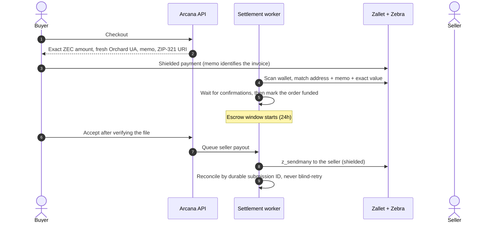
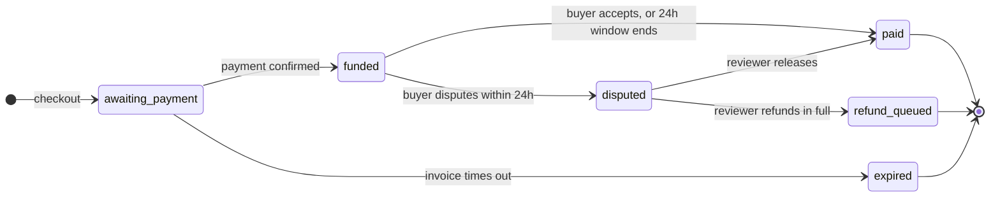
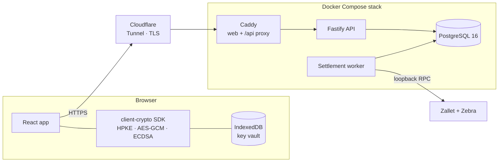

# Gallery Arcana · ZECATHON submission

**A private market for digital goods. Discover, negotiate and exchange, paid in shielded ZEC.**

`Track: Private Markets` · [Live demo](https://gallery-arcana.timioni1490.workers.dev) · [Code](https://github.com/Timioni001/Gallery-Arcana) · [README](README.md)

---

## Contents

1. [The 30-second version](#1-the-30-second-version)
2. [The problem](#2-the-problem)
3. [What we built](#3-what-we-built)
4. [Why it does not leak](#4-why-it-does-not-leak)
5. [How Zcash is used](#5-how-zcash-is-used)
6. [Escrow with a clock](#6-escrow-with-a-clock)
7. [What is real and what is a mock](#7-what-is-real-and-what-is-a-mock)
8. [Two-minute judge walkthrough](#8-two-minute-judge-walkthrough)
9. [Architecture](#9-architecture)
10. [Engineering quality](#10-engineering-quality)
11. [Run it yourself](#11-run-it-yourself)
12. [Known limitations](#12-known-limitations)
13. [Roadmap](#13-roadmap)
14. [Team and disclosure](#14-team-and-disclosure)

---

## 1. The 30-second version

Buying a digital good online today publishes a trail: your account, your wallet, the price you paid, what you bought and who you bought it from. Gallery Arcana is a marketplace where none of that becomes public.

| | |
| --- | --- |
| **Who it's for** | Artists, developers and collectors selling files, editions, code, datasets and digital property |
| **Payment** | Shielded ZEC, one fresh Orchard address and memo per invoice |
| **Delivery** | Files encrypted in the seller's browser; each buyer receives their own sealed key |
| **Protection** | Escrow: the buyer verifies the file before the seller is paid, with a 24-hour deadline |
| **Proof** | Signed receipts and Trade Passports that prove a sale only to the people you choose |
| **Try it** | [gallery-arcana.timioni1490.workers.dev](https://gallery-arcana.timioni1490.workers.dev), no signup wall, runs in your browser |

## 2. The problem

Private payment alone doesn't make private commerce. Even with a shielded transaction, a typical marketplace still leaks:

- **Identity.** Accounts are tied to emails, phone numbers or KYC.
- **Purchase history.** Profiles and public activity feeds show what you bought and when.
- **Prices.** Public sales history and public bid ladders reveal what you paid.
- **The goods themselves.** The platform stores the file in plaintext and can read, scan or leak it.
- **Negotiation.** Offers and messages sit unencrypted on the server.
- **Trust.** Escrow either doesn't exist (the seller is paid before you look) or never ends (sellers wait forever).

Zcash solves the payment layer. Gallery Arcana is the marketplace layer built on top so the rest of the trade doesn't undo it.

## 3. What we built

<table>
<tr><td width="50%"> <b>Market.</b> Public listings only. Buyers and offers are never shown.</td>
<td width="50%"> <b>Sealed-bid auctions.</b> Rivals see a bid count, never amounts.</td></tr>
<tr><td colspan="2"> <b>Mobile-first.</b> Home, market, auctions and the full-screen artwork viewer.</td></tr>
</table>

| Feature | What it does |
| --- | --- |
| **Alias accounts** | An alias and a passphrase. No email, phone or ID. Passphrases are hashed with scrypt and a per-user salt. |
| **Capsules** | Files are encrypted in the seller's browser in authenticated chunks. The server stores ciphertext only. |
| **Sealed key envelopes** | The content key is sealed to one buyer's public key (HPKE). Only that buyer can open it. |
| **Private negotiation** | Offers and counteroffers are never public. Chat and attachments are end-to-end encrypted. |
| **Shielded checkout** | Exact ZEC amount, fresh Orchard address and memo, ZIP-321 payment URI. |
| **Escrow** | Funds are held until the buyer accepts, a 24-hour window ends, or a reviewer decides a dispute. |
| **Encrypted disputes** | Evidence is encrypted to the assigned reviewer only. Decision due within 7 days. |
| **Signed receipts** | Ed25519 proof of how a sale completed: accepted, auto-released or reviewer-released. |
| **Trade Passports** | Prove a trading history to one party, with minimal facts, expiry and revocation. |
| **Asset control checks** | Prove control of a domain, GitHub repo or wallet without handing it over. |
| **Sealed-bid auctions** | Second-price: highest bid wins and pays the runner-up price, so bidding your true maximum is safe. |
| **Private invitations** | Single-use, expiring links that sell a listing to one designated buyer. |

## 4. Why it does not leak

Each leak from section 2, and what stops it.

| Leak | How Gallery Arcana stops it |
| --- | --- |
| Identity | Alias + passphrase only. Rate limiting uses hashed IPs; no tracking or analytics. |
| Wallet linkage | A fresh Orchard address for every invoice, so two purchases never share an address. |
| Price paid | Shielded amounts on chain; no public sales history; sellers see their own sales, not who bought. |
| Bids | No public bid feed. Auctions are sealed; only the bid count is visible. |
| File contents | Encrypted in the seller's browser; the content key never reaches the server. |
| Messages | End-to-end encrypted; the server relays ciphertext. |
| Dispute evidence | Encrypted to the assigned reviewer; expires within 30 days. |
| Long-term records | 30 days after settlement, the buyer link, payment notes and evidence are scrubbed. |

**Honest boundary.** Shielding protects the onchain payment details. It doesn't hide the application metadata the marketplace itself must keep to settle an order (price, status, timestamps), and offer amounts are operator-readable so settlement can be checked. This is documented, not hidden: see [THREAT_MODEL.md](docs/THREAT_MODEL.md).

## 5. How Zcash is used

Zcash isn't a logo on this project; it's the settlement rail.

- **Fresh Orchard-only unified address per invoice**, drawn from a pre-generated pool, never reused.
- **Memo matching**: the invoice memo, address and exact zatoshi value must all match.
- **Integer-zatoshi accounting** end to end; no floating-point money anywhere.
- **Confirmations** (default 2) before an order counts as funded.
- **Edge cases handled explicitly**: underpayment never delivers; overpayment and late payments are refundable; a reorganisation that removes a confirmed payment freezes the order for manual review.
- **Payouts are idempotent**: an uncertain send is reconciled by its durable submission ID and is never resent blindly.
- **Live ZEC/USD price** from a market feed on testnet, with a maximum quote age; stale prices pause new checkouts but never block settlement.
- **Wallet behind an interface** (`WalletAdapter`) with two drivers: a durable database mock for development, and a **Zallet** driver for testnet and regtest.

## 6. Escrow with a clock

Most escrow fails one side. If the seller is paid first, buyers have no protection. If funds wait for buyer approval with no deadline, a silent buyer can hold a seller's money forever. Gallery Arcana fixes both.

| Rule | Detail |
| --- | --- |
| Review window | **24 hours** from funding (`ESCROW_REVIEW_HOURS`). Accepting releases payment immediately. |
| Auto-release | If the window ends with no acceptance and no dispute, the worker releases the payment. The signed receipt records `auto_release`. |
| Dispute | Must be opened inside the window; freezes the funds. A reviewer must decide within **7 days** (`ESCROW_DISPUTE_DAYS`): release, or refund in full. |
| Fixed per order | Deadlines are stored on the order when it's funded or disputed. Changing the settings never shortens an existing order. |
| Race-safe | Auto-release re-checks the order under a row lock, so a concurrent acceptance or dispute wins or loses atomically, and a release happens at most once. |

The public demo shortens the window to 10 minutes so you can watch an automatic release. The full rules are published at `GET /api/terms` and on the [Terms page](https://gallery-arcana.timioni1490.workers.dev/terms#escrow).

## 7. What is real and what is a mock

We'd rather you trust this section than be surprised later.

### Real

| Component | Status |
| --- | --- |
| Client cryptography | Real: chunked AES-GCM capsules, HPKE key envelopes, encrypted conversations, ECDSA identities with key pinning, browser key vault with backup and restore. |
| Backend | Real: Fastify API + PostgreSQL + separate settlement worker, with checksummed, transactional migrations. |
| Settlement logic | Real and tested: exact-value matching, confirmations, expiry, under/over/late payments, reorg freezes, escrow deadlines, idempotent payouts. |
| Zallet adapter | Real code against the Zallet JSON-RPC interface, with a scripted end-to-end journey (`npm run regtest -- journey`) for real Zebra + Zallet binaries on local regtest. |
| Hosted demo crypto | Real: the demo encrypts, seals and decrypts files with the same SDK. |

### Mock or simulated

| Component | Status |
| --- | --- |
| Hosted demo backend | Simulated: the whole API runs inside your browser (IndexedDB). Nothing leaves your device except the waitlist form. |
| Demo payments | Simulated: they auto-confirm a few seconds after checkout. No ZEC moves. |
| Demo counterparties | Simulated: sample sellers accept offers and reply to messages; auction rivals are simulated. |
| Demo receipts | Signed with a demo key held in your browser, not the platform's Ed25519 key. |
| Public testnet | Implemented and gated behind an explicit acknowledgement, **not yet verified live**. See [ZALLET_GAP.md](docs/ZALLET_GAP.md). |
| Mainnet | Disabled. |

## 8. Two-minute judge walkthrough

Open the [live demo](https://gallery-arcana.timioni1490.workers.dev) on any device.

| Step | Do this | What it proves |
| --- | --- | --- |
| 1 | Tap **Get started** and create an alias and passphrase. | No email, phone or ID needed. |
| 2 | Open **Market** and pick an Arcana Fragment (marked *Capsule*). | The file is a sealed capsule; only a preview is public. |
| 3 | Make an offer, or open the encrypted chat with the seller. | Negotiation is private; the simulated seller replies. |
| 4 | Check out. Note the single-use address, memo and ZIP-321 URI. | How a real shielded invoice is formed. |
| 5 | Wait a few seconds for the simulated payment. | The order becomes *funded*; the escrow clock starts. |
| 6 | Tap **Decrypt locally & verify**. | Your browser opens the sealed key and checks the SHA-256. |
| 7 | **Accept**, or wait 10 minutes for auto-release. | Payment releases; a signed receipt is issued. |
| 8 | Open **Observer view**. | What an outsider can see: nothing about your trade. |
| 9 | Try **Auctions** and place a sealed bid. | Rivals see the count, never the amount. |

## 9. Architecture

- **Separation of duties.** The API never holds wallet credentials; only the worker does, and the wallet RPC is reachable on loopback only.
- **No inbound ports.** Production runs behind a Cloudflare Tunnel.
- **Two deployment modes.** A full Docker stack, or a zero-server static demo on Cloudflare Workers with a KV-backed waitlist.

| Layer | Stack |
| --- | --- |
| Frontend | React 19, Vite, Tailwind v4, Base UI |
| Crypto SDK | WebCrypto + `@hpke/core` (workspace package `@gallery-arcana/client-crypto`) |
| Backend | Node.js 22, TypeScript, Fastify, PostgreSQL 16 |
| Wallet | Zallet JSON-RPC (testnet / regtest), durable mock for development |
| Deploy | Docker Compose, Caddy, Cloudflare Tunnel, Cloudflare Workers + KV |

## 10. Engineering quality

- **Tests.** Unit, security and RPC-contract tests (`npm test`), plus PostgreSQL integration suites that create and drop an isolated database per file (`npm run test:integration`). Covered: the full purchase journey, concurrent checkout, races between acceptance, dispute and auto-release, expiry, partial, late and excess payments, output replay, chain reorganisations, worker crash and restart, payout reconciliation, retention scrubbing, and the escrow window.
- **Browser journeys** run in Chromium: capsule sale, local decryption, encrypted chat, passport verification, dispute evidence and vault restore.
- **Database invariants** are enforced by constraints, not just code: one completed sale per listing, immutable file fingerprints, unique payout per order.
- **Security headers** and a strict Content-Security-Policy; all mutations require an action header plus origin and fetch-site checks; session cookies are HttpOnly and SameSite=Strict.
- **Documented**: API contract, threat model, crypto protocol, invariants, operations, deploy and testnet runbooks in [`docs/`](docs).

## 11. Run it yourself

| Goal | Command |
| --- | --- |
| Use the demo | Open [the live site](https://gallery-arcana.timioni1490.workers.dev) |
| Build the demo | `cd web && npm ci && npm run build:demo` |
| Full stack on Ubuntu / WSL2 | `npm run setup:wsl && npm run dev` |
| Full stack in Docker | `cd deploy && ./init.sh && docker compose up -d --build` |
| Real Zebra + Zallet on regtest | See [REGTEST.md](docs/REGTEST.md), then `npm run regtest -- setup`, `fund`, `journey` |
| Tests | `npm test`, `npm run test:integration`, `npm run typecheck` |

Requirements: Node.js 22+, PostgreSQL 16 for the full stack, Docker Compose v2.24+ for self-hosting. Details in the [README](README.md#running-requirements).

## 12. Known limitations

- Public-testnet settlement is implemented but not yet verified against a live chain; mainnet is disabled.
- The marketplace is custodial during escrow. Non-custodial threshold escrow depends on FROST-style signing for shielded pools, which isn't production-ready yet.
- First-contact key fingerprints should be compared out of band; static recipient keys provide no forward secrecy.
- Onchain assets and digital property can be listed and negotiated, but their transfer happens outside the platform.
- Signed receipts prove a platform transaction, not legal ownership.
- No independent security audit yet.

## 13. Roadmap

| Next | Why |
| --- | --- |
| Verified public-testnet settlement | Close the gap between the scripted regtest journey and a live chain. |
| zkSNARKs featured collection | The upcoming collection of shielded identities, sold as sealed capsules. |
| Viewing-key disclosure | Let a buyer prove a specific payment to an auditor without revealing others. |
| Threshold escrow | Move from custodial holding to 2-of-3 release once shielded threshold signing matures. |
| Seller tools | Bulk capsule upload, editions, and invitation campaigns. |
| Mainnet | Only after testnet verification, an external audit and a legal review. |

## 14. Team and disclosure

- **Builder:** Timi ([@0x_TIMii](https://x.com/0x_TIMii)).
- **AI assistance:** parts of the code, tests and documentation were written with Claude Code; commits it co-authored are marked in the git history. Every design decision, deployment and submission is the builder's.
- **License and use:** lawful digital commerce only. This is a testnet preview, not a custodian of real funds.

Built for ZECATHON · Private Markets · Powered by Zcash

