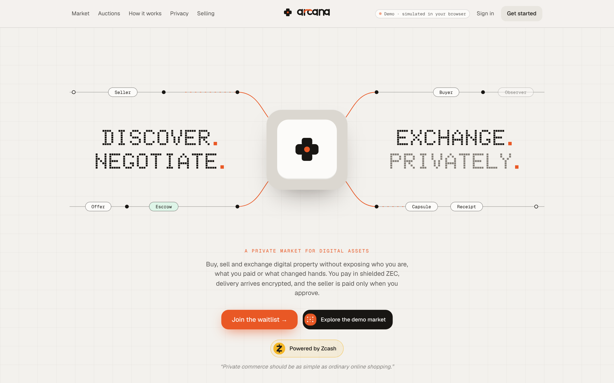
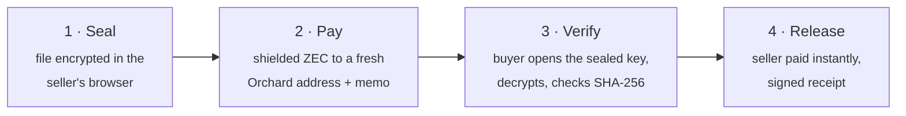
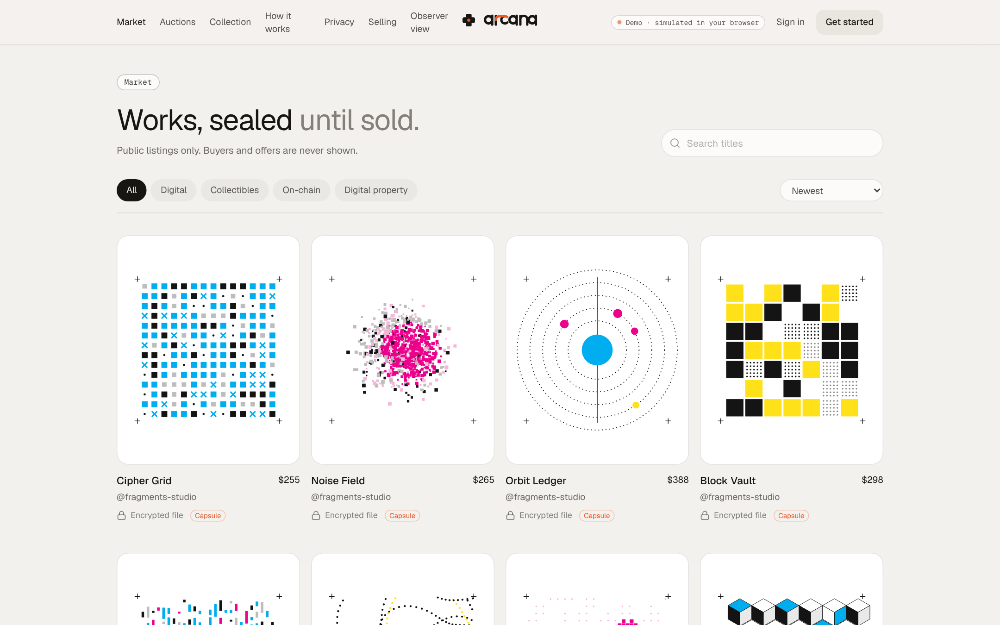
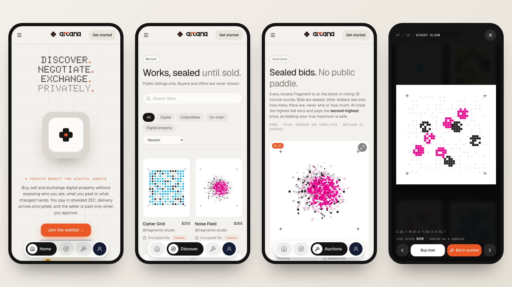
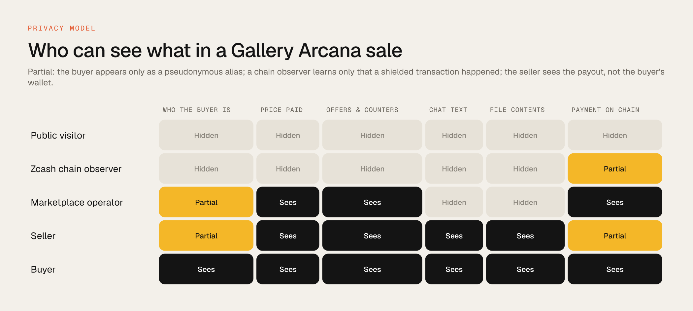
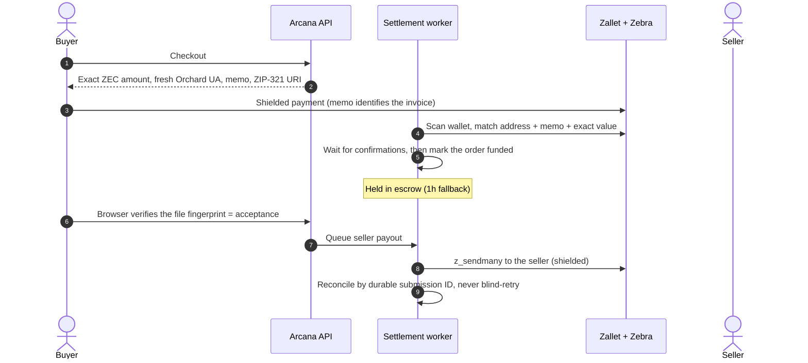
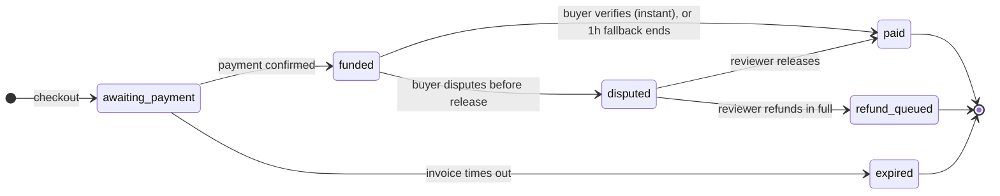
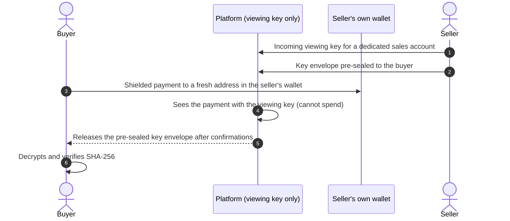
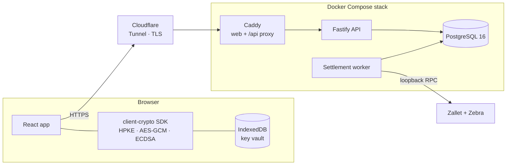

# Gallery Arcana · ZECATHON submission

**A private market for digital goods. Discover, negotiate and exchange, paid in shielded ZEC.**

`Track: Private Markets` · [Live demo](https://gallery-arcana.timioni1490.workers.dev) · [Code](https://github.com/Timioni001/Gallery-Arcana) · [README](README.md)

---

## Contents

1. [The 30-second version](#1-the-30-second-version)
2. [One flow, end to end](#2-one-flow-end-to-end)
3. [Where this fits next to Zilk Road](#3-where-this-fits-next-to-zilk-road)
4. [The problem](#4-the-problem)
5. [What we built](#5-what-we-built)
6. [What stays private, and from whom](#6-what-stays-private-and-from-whom)
7. [How Zcash is used](#7-how-zcash-is-used)
8. [Escrow with a clock](#8-escrow-with-a-clock)
9. [Custody: v1 today, non-custodial next](#9-custody-v1-today-non-custodial-next)
10. [Implemented vs verified](#10-implemented-vs-verified)
11. [Two-minute judge walkthrough](#11-two-minute-judge-walkthrough)
12. [Architecture](#12-architecture)
13. [Engineering quality](#13-engineering-quality)
14. [Run it yourself](#14-run-it-yourself)
15. [Known limitations](#15-known-limitations)
16. [Roadmap](#16-roadmap)
17. [Team and disclosure](#17-team-and-disclosure)

---

## 1. The 30-second version

Buying a digital good online publishes a trail: your account, your wallet, what you paid, what you bought and who from. Gallery Arcana is built around one flow that keeps that trail off the public record:

> **Seal** the file in the seller's browser → **pay** in shielded ZEC → the buyer's browser **verifies** the exact file → the seller is **paid**.

| | |
| --- | --- |
| **Who it's for** | Artists, developers and collectors selling files, editions, code and datasets |
| **Payment** | Shielded ZEC, one fresh Orchard address and memo per invoice |
| **Delivery** | Files encrypted in the seller's browser; each buyer receives their own sealed key |
| **Release** | Instant when the buyer's browser verifies the file's fingerprint; 1-hour fallback if they never open it |
| **Proof** | A signed receipt that attests the platform sale (not legal ownership) |
| **Try it** | [gallery-arcana.timioni1490.workers.dev](https://gallery-arcana.timioni1490.workers.dev), mock settlement, runs in your browser |

## 2. One flow, end to end

Everything else in the project supports this path. Each step is something a judge can check.

| Step | What happens | What it proves | Where |
| --- | --- | --- | --- |
| **1. Seal** | The seller's browser encrypts the file in authenticated chunks and uploads ciphertext. The content key never leaves the seller's device unencrypted. | The server can't read the goods. | `packages/client-crypto`, studio upload |
| **2. Pay** | Checkout issues an exact zatoshi amount, a single-use Orchard address and a memo (ZIP-321). The worker matches address, memo and value and waits for confirmations. | Payment is shielded and tied to exactly one invoice. | `src/services/checkout.ts`, `src/jobs/watcher.ts` |
| **3. Verify** | The buyer receives a key envelope sealed to their key (HPKE), decrypts locally and checks the file's SHA-256 against the checkout snapshot. | The buyer got exactly the file that was listed. | order page, `openPurchasedCapsule` |
| **4. Release** | A matching fingerprint completes the order: the seller payout is queued and an Ed25519 receipt is signed. A mismatch never releases. | The seller is paid only after correct delivery. | `src/services/acquisitions.ts` |

Status: **settled with real shielded transactions on local regtest** (real Zebra 6.2.3 and Zallet v0.1.0-beta.1, private chain, no value): buyer payment `796661ddbdcc…`, seller payout `5240770fc148…`, recorded in [settlement-regtest-2026-10-27T23-55-54-663Z.json](docs/evidence/settlement-regtest-2026-10-27T23-55-54-663Z.json). The same flow runs in automated browser journeys and database tests on the mock wallet ([VALIDATION.md](docs/VALIDATION.md)). Public-testnet verification is in progress.

## 3. Where this fits next to Zilk Road

zkSNARKs runs [Zilk Road](https://zilkroad.com), the official marketplace for the zkSNARKs collection of shielded identities on Zcash, with listings, offers and shielded bidder identities. Gallery Arcana is aimed at a different kind of good: **files whose contents must stay private until a buyer pays**, such as source code, datasets, design files and unreleased work.

| | Zilk Road | Gallery Arcana |
| --- | --- | --- |
| Primary good | The zkSNARKs collection | Encrypted digital files |
| Core question answered | Who owns which identity | Did the buyer receive exactly the file they paid for, without the platform seeing it |
| Distinctive mechanism | Shielded bidding and sales of a collection | Browser-side encryption, buyer-sealed keys, verification-gated release |

The two are complementary: encrypted delivery and verified release are building blocks a collection marketplace could use for unlockable content.

## 4. The problem

Private payment alone doesn't make private commerce. Even with a shielded transaction, a typical marketplace still leaks:

- **Identity.** Accounts are tied to emails, phone numbers or KYC.
- **Purchase history.** Profiles and public activity feeds show what you bought and when.
- **Prices.** Public sales history and public bid ladders reveal what you paid.
- **The goods themselves.** The platform stores the file in plaintext and can read, scan or leak it.
- **Negotiation.** Offers and messages sit unencrypted on the server.
- **Trust.** Escrow either doesn't exist (the seller is paid before you look) or never ends (sellers wait forever).

Zcash solves the payment layer. Gallery Arcana is the marketplace layer built on top so the rest of the trade doesn't undo it.

## 5. What we built

<table>
<tr><td width="50%"> <b>Market.</b> Public previews; buyers and offers are not shown.</td>
<td width="50%"> <b>Mobile.</b> Home, market and the artwork viewer.</td></tr>
</table>

### Core

| Feature | What it does |
| --- | --- |
| **Capsules** | Files encrypted in the seller's browser in authenticated chunks; the server stores ciphertext only. |
| **Sealed key envelopes** | The content key is sealed to one buyer's public key (HPKE); only that buyer can open it. |
| **Shielded checkout** | Exact ZEC amount, fresh Orchard address and memo, ZIP-321 payment URI. |
| **Verified release** | The order completes when the buyer's browser verifies the file; 1-hour fallback; disputes freeze funds. |
| **Signed receipts** | Ed25519 record of how a sale completed: verified, auto-released or reviewer-released. |
| **Alias accounts** | An alias and a passphrase (scrypt, per-user salt). No email, phone or ID. |

### Also built

Supporting features, implemented and tested, but not the focus of this submission:

- **Private negotiation:** offers and counteroffers, plus end-to-end encrypted chat and attachments.
- **Encrypted disputes:** evidence sealed to an assigned reviewer; 7-day decision deadline.
- **Private invitations:** single-use, expiring links that sell to one designated buyer.
- **Trade Passports:** prove a trading history to one party, with minimal facts, expiry and revocation.
- **Asset-control checks:** prove control of a domain, GitHub repo or wallet without handing it over.
- **Auctions** *(simulation)***:** a front-end demonstration of sealed-bid, second-price rules; not connected to settlement.

## 6. What stays private, and from whom

Each leak from section 2, and what reduces it. Privacy here is a set of specific, testable properties against specific observers, not a promise of anonymity.

| Leak | How Gallery Arcana stops it |
| --- | --- |
| Identity | Alias + passphrase only. Rate limiting uses hashed IPs; no tracking or analytics. |
| Wallet linkage | A fresh Orchard address for every invoice, so two purchases never share an address. |
| Price paid | Shielded amounts on chain; no public sales history; sellers see their own sales, not who bought. |
| Offers | No public bid feed or offer history; offers are visible only to the two parties and the operator. |
| File contents | Encrypted in the seller's browser; the content key never reaches the server. |
| Messages | End-to-end encrypted; the server relays ciphertext. |
| Dispute evidence | Encrypted to the assigned reviewer; expires within 30 days. |
| Long-term records | 30 days after settlement, the buyer link, payment notes and evidence are scrubbed. |

**Honest boundary.** Shielding protects the onchain payment details. It doesn't hide the application metadata the marketplace itself must keep to settle an order (price, status, timestamps), and offer amounts are operator-readable so settlement can be checked. This is documented, not hidden: see [THREAT_MODEL.md](docs/THREAT_MODEL.md).

## 7. How Zcash is used

Zcash isn't a logo on this project; it's the settlement rail.

- **Fresh Orchard-only unified address per invoice**, drawn from a pre-generated pool, never reused.
- **Memo matching**: the invoice memo, address and exact zatoshi value must all match.
- **Integer-zatoshi accounting** end to end; no floating-point money anywhere.
- **Confirmations** (default 2) before an order counts as funded.
- **Edge cases handled explicitly**: underpayment never delivers; overpayment and late payments are refundable; a reorganisation that removes a confirmed payment freezes the order for manual review.
- **Payouts are idempotent**: an uncertain send is reconciled by its durable submission ID and is never resent blindly.
- **Live ZEC/USD price** from a market feed on testnet, with a maximum quote age; stale prices pause new checkouts but never block settlement.
- **Wallet behind an interface** (`WalletAdapter`) with two drivers: a durable database mock for development, and a **Zallet** driver for testnet and regtest.

## 8. Escrow with a clock

Most escrow fails one side. If the seller is paid first, buyers have no protection. If funds wait for buyer approval with no deadline, a silent buyer can hold a seller's money forever. Gallery Arcana pays the seller the moment the buyer's browser proves the right file arrived, with a short fallback for buyers who never check.

| Rule | Detail |
| --- | --- |
| Instant release | When the buyer's browser downloads (and for capsules, decrypts) the file and its SHA-256 matches the checkout snapshot, the order completes immediately. Verifying is the acceptance. A mismatch never releases. |
| Fallback | **1 hour** from funding (`ESCROW_REVIEW_HOURS`). If the buyer never verifies and doesn't dispute, the worker releases the payment. |
| Auto-release | The signed receipt records `auto_release`, distinct from `buyer_accepted` and `operator_release`. |
| Dispute | Must be opened before release; freezes the funds. A reviewer must decide within **7 days** (`ESCROW_DISPUTE_DAYS`): release, or refund in full. |
| Fixed per order | Deadlines are stored on the order when it's funded or disputed. Changing the settings never shortens an existing order. |
| Race-safe | Auto-release re-checks the order under a row lock, so a concurrent acceptance or dispute wins or loses atomically, and a release happens at most once. |

### Who controls the money, and what the operator sees

Escrow here is **custodial**. While an order is funded, the buyer's ZEC sits in the platform's wallet and the platform alone can move it: by releasing it to the seller (on acceptance, on automatic release, or on a reviewer's decision) or by refunding it in full. Neither party can move escrowed funds directly.

Because it settles the order, the operator necessarily sees the financial side of every trade:

| The operator sees | The operator does not see |
| --- | --- |
| Price in USD and exact ZEC amount | File contents (encrypted in the seller's browser) |
| Invoice address, memo and confirmations | Content keys (sealed to the buyer) |
| Offer and counteroffer amounts | Chat text and attachments (end-to-end encrypted) |
| Payout and refund destinations and transaction IDs | Dispute evidence (encrypted to the assigned reviewer) |
| When each order was funded, accepted, disputed, released or refunded | The buyer's wallet balance or other transactions |
| Which alias bought and which alias sold | Real names, emails or IDs (never collected) |

These are two different kinds of control. **Client-side encryption** is a cryptographic guarantee: the server holds ciphertext and cannot read it. **Escrow** is an operational control: buyers are protected by rules the platform enforces (deadlines, disputes, full refunds), and by signed receipts that record how each order ended. Shielded payments protect the trade from outside observers on chain; they do not hide it from the platform that settles it.

The public demo uses a 10-minute fallback so you can watch an automatic release. The full rules are published at `GET /api/terms` and on the [Terms page](https://gallery-arcana.timioni1490.workers.dev/terms#escrow).

## 9. Custody: v1 today, non-custodial next

Escrow in this submission is custodial: funds sit in the platform's wallet until release or refund. That's a deliberate v1 trade-off, because it gives buyers refunds and disputes, but it means trusting the operator with money. Here is the design we intend to move to.

| | v1 (this submission) | Next: non-custodial |
| --- | --- | --- |
| Who holds funds | Platform wallet | Seller's own wallet, from the first block |
| Platform's Zcash access | Spending key for escrow | Incoming viewing key only: can see payments, cannot move them |
| Non-delivery risk | Covered by escrow and refunds | Removed: the key is released automatically on payment |
| "Not as described" risk | Dispute and refund | No refund path; covered by previews, receipts and Trade Passports |
| Operator visibility | Amounts and order metadata | Payments to sellers' sales accounts and order metadata |

This is a design, not an implemented feature. It depends on the wallet stack importing an incoming viewing key for watch-only scanning, which we still have to confirm against Zallet. It also gives up refunds, so it would be offered alongside, not instead of, the protected mode until reputation tools mature.

## 10. Implemented vs verified

We'd rather you trust this section than be surprised later. *Implemented* means the code exists and is covered by automated tests. *Verified* means it has been demonstrated against that environment with recorded evidence.

### Settlement modes

| Mode | What moves | Status | Evidence |
| --- | --- | --- | --- |
| **Mock wallet** | Nothing on any chain. A durable database ledger stands in for the wallet. | Implemented and verified by tests. Default for local development. | Integration test suites (see [VALIDATION.md](docs/VALIDATION.md)) |
| **Hosted demo** | Nothing. The API runs in your browser and payments auto-confirm. | Live at the demo URL. | Clearly labelled on the site |
| **Local regtest** | Real shielded transactions between real **Zebra** and **Zallet** binaries on a private chain. Coins have no value. | **Verified 2026-10-27.** One full purchase: shielded payment funded the invoice, the buyer verified the file, the seller payout was sent and verified on chain. | [settlement-regtest-2026-10-27T23-55-54-663Z.json](docs/evidence/settlement-regtest-2026-10-27T23-55-54-663Z.json) and [SETTLEMENT_EVIDENCE.md](docs/SETTLEMENT_EVIDENCE.md) |
| **Public testnet** | Testnet ZEC on the public Zcash testnet. | Implemented and gated behind `ZALLET_TESTNET_ACK`. **Live verification in progress.** | Blockers recorded in [zcash-testnet-v05.json](docs/evidence/zcash-testnet-v05.json) and [ZALLET_GAP.md](docs/ZALLET_GAP.md) |
| **Mainnet** | — | Disabled. | — |

### Implemented and tested

| Component | Detail |
| --- | --- |
| Client cryptography | Chunked AES-GCM capsules, HPKE key envelopes, encrypted conversations, ECDSA identities with key pinning, browser key vault with backup and restore. |
| Backend | Fastify API + PostgreSQL + separate settlement worker, with checksummed, transactional migrations. |
| Settlement logic | Exact-value matching, confirmations, expiry, under/over/late payments, reorg freezes, escrow deadlines, idempotent payouts. |
| Zallet adapter | Zallet JSON-RPC driver for testnet and regtest. Verified on local regtest against real binaries; three response-format differences found there were fixed and covered by tests. |

### Simulated

| Component | Detail |
| --- | --- |
| Auctions | A front-end simulation of sealed-bid, second-price rules. Rival bids are generated; bids are not settled. |
| Demo counterparties | Sample sellers in the hosted demo accept offers and reply automatically. They are labelled as automated. |
| Demo payments | Auto-confirm a few seconds after checkout. No ZEC moves. |
| Demo receipts | Signed with a key held in your browser, not the platform's Ed25519 key. |

## 11. Two-minute judge walkthrough

Open the [live demo](https://gallery-arcana.timioni1490.workers.dev) on any device. The demo is mock settlement: no ZEC moves. The latest automated results are in [VALIDATION.md](docs/VALIDATION.md).

| Step | Do this | What it proves |
| --- | --- | --- |
| 1 | Tap **Get started** and create an alias and passphrase. | No email, phone or ID needed. |
| 2 | Open **Market** and pick an Arcana Fragment (marked *Capsule*). | The file is a sealed capsule; only a preview is public. |
| 3 | Make an offer, or open the encrypted chat with the seller. | Negotiation is end-to-end encrypted; the sample seller replies automatically. |
| 4 | Check out. Note the single-use address, memo and ZIP-321 URI. | How a real shielded invoice is formed. |
| 5 | Wait a few seconds for the simulated payment. | The order becomes *funded*; funds are held in escrow. |
| 6 | Tap **Decrypt locally & verify**. | Your browser opens the sealed key and checks the SHA-256; a match releases payment instantly. |
| 7 | See the order turn **Paid** with a signed receipt. | Verified delivery is the acceptance; no extra click. |
| 8 | Open **Observer view**. | Which requests an outsider can make, and that buyer and offer data are refused. |
| 9 | *(Optional)* Try **Auctions**. | A labelled simulation of sealed-bid rules; not settled. |

## 12. Architecture

- **Separation of duties.** The API never holds wallet credentials; only the worker does, and the wallet RPC is reachable on loopback only.
- **No inbound ports.** Production runs behind a Cloudflare Tunnel.
- **Two deployment modes.** A full Docker stack, or a zero-server static demo on Cloudflare Workers with a KV-backed waitlist.

| Layer | Stack |
| --- | --- |
| Frontend | React 19, Vite, Tailwind v4, Base UI |
| Crypto SDK | WebCrypto + `@hpke/core` (workspace package `@gallery-arcana/client-crypto`) |
| Backend | Node.js 22, TypeScript, Fastify, PostgreSQL 16 |
| Wallet | Zallet JSON-RPC (testnet / regtest), durable mock for development |
| Deploy | Docker Compose, Caddy, Cloudflare Tunnel, Cloudflare Workers + KV |

## 13. Engineering quality

- **Tests.** Unit, security and RPC-contract tests (`npm test`), plus PostgreSQL integration suites that create and drop an isolated database per file (`npm run test:integration`). Covered: the full purchase journey, concurrent checkout, races between acceptance, dispute and auto-release, expiry, partial, late and excess payments, output replay, chain reorganisations, worker crash and restart, payout reconciliation, retention scrubbing, and the escrow window.
- **Browser journeys** run in Chromium: capsule sale, local decryption, encrypted chat, passport verification, dispute evidence and vault restore.
- **Database invariants** are enforced by constraints, not just code: one completed sale per listing, immutable file fingerprints, unique payout per order.
- **Security headers** and a strict Content-Security-Policy; all mutations require an action header plus origin and fetch-site checks; session cookies are HttpOnly and SameSite=Strict.
- **Documented**: API contract, threat model, crypto protocol, invariants, operations, deploy and testnet runbooks in [`docs/`](docs).

## 14. Run it yourself

| Goal | Command |
| --- | --- |
| Use the demo | Open [the live site](https://gallery-arcana.timioni1490.workers.dev) |
| Build the demo | `cd web && npm ci && npm run build:demo` |
| Full stack on Ubuntu / WSL2 | `npm run setup:wsl && npm run dev` |
| Full stack in Docker | `cd deploy && ./init.sh && docker compose up -d --build` |
| Real Zebra + Zallet on regtest | See [REGTEST.md](docs/REGTEST.md), then `npm run regtest -- setup`, `fund`, `journey` |
| Tests | `npm test`, `npm run test:integration`, `npm run typecheck` |

Requirements: Node.js 22+, PostgreSQL 16 for the full stack, Docker Compose v2.24+ for self-hosting. Details in the [README](README.md#running-requirements).

## 15. Known limitations

- Public-testnet settlement is implemented; live-chain verification is in progress. Mainnet is disabled.
- The marketplace is custodial during escrow. The non-custodial, viewing-key design in [section 9](#9-custody-v1-today-non-custodial-next) is the planned replacement and depends on confirming watch-only viewing-key support in Zallet.
- First-contact key fingerprints should be compared out of band; static recipient keys provide no forward secrecy.
- Onchain assets and digital property can be listed and negotiated, but their transfer happens outside the platform.
- Signed receipts prove a platform transaction, not legal ownership.
- No independent security audit yet.

## 16. Roadmap

| Next | Why |
| --- | --- |
| Verified public-testnet settlement | Repeat the verified regtest journey on the public testnet. |
| zkSNARKs featured collection | The upcoming collection of shielded identities, sold as sealed capsules. |
| Viewing-key disclosure | Let a buyer prove a specific payment to an auditor without revealing others. |
| Non-custodial mode | Sellers paid directly; the platform watches with an incoming viewing key and releases the pre-sealed key on payment ([section 9](#9-custody-v1-today-non-custodial-next)). |
| Seller tools | Bulk capsule upload, editions, and invitation campaigns. |
| Mainnet | Only after testnet verification, an external audit and a legal review. |

## 17. Team and disclosure

- **Builder:** Timi ([@0x_TIMii](https://x.com/0x_TIMii)).
- **AI assistance:** parts of the code, tests and documentation were written with Claude Code; commits it co-authored are marked in the git history. Every design decision, deployment and submission is the builder's.
- **License and use:** lawful digital commerce only. This is a testnet preview, not a custodian of real funds.

Built for ZECATHON · Private Markets · Powered by Zcash

