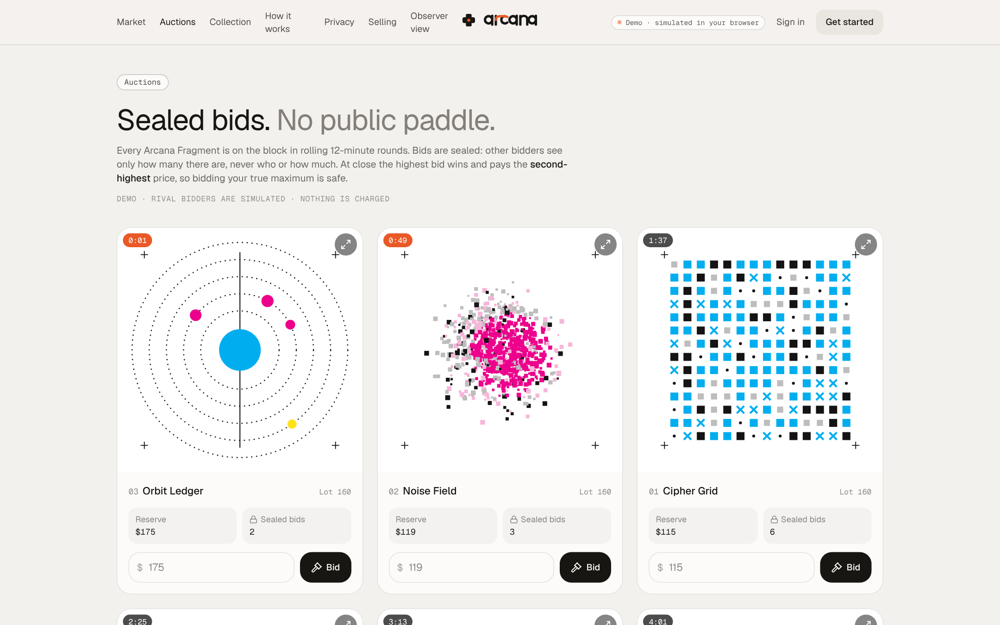
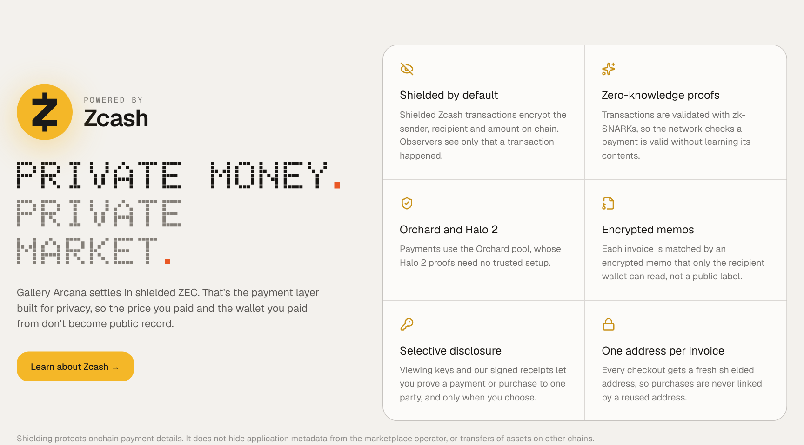
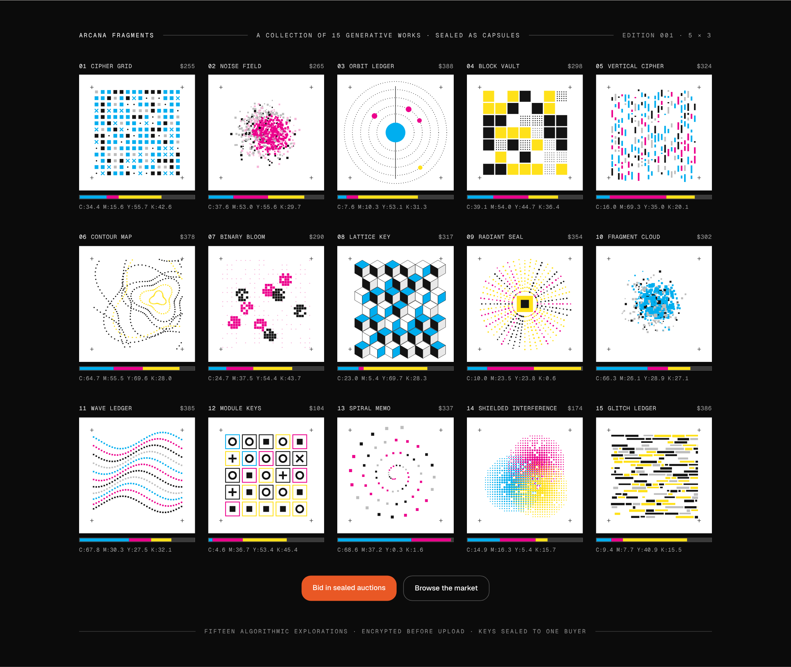
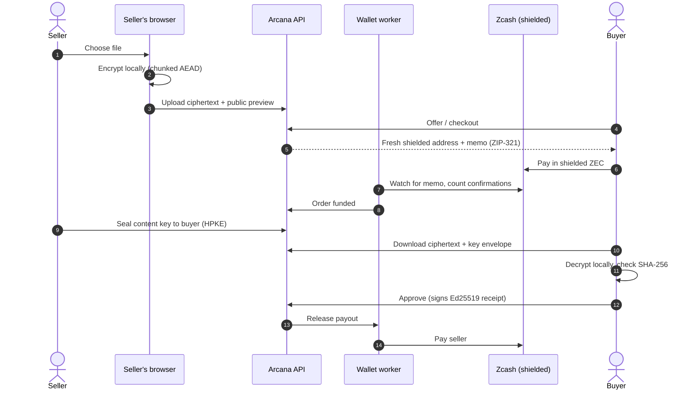
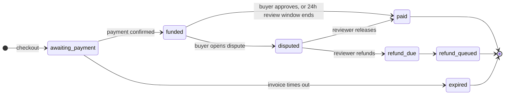
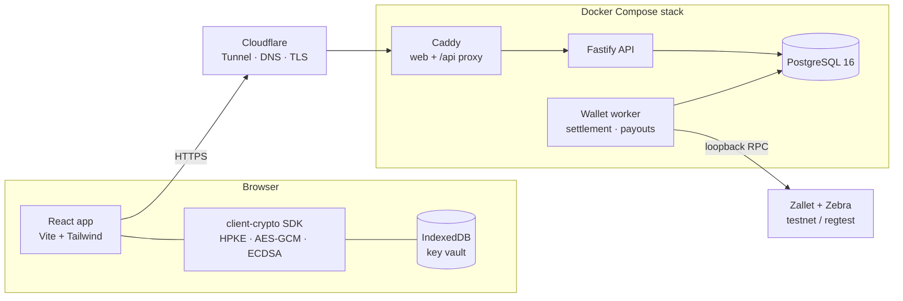
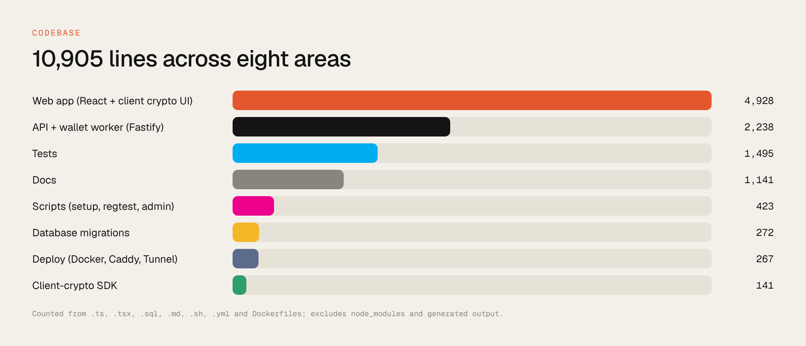

<div align="center">

# Gallery Arcana

**A private market for digital assets. Discover, negotiate and exchange, paid in shielded Zcash.**

[Live demo](https://gallery-arcana.timioni1490.workers.dev) · [How it works](#how-a-sale-works) · [Run it](#running-requirements) · [Docs](#documentation)


</div>

Gallery Arcana lets people buy and sell digital property without exposing who they are, what they paid or what changed hands:

- **Shielded payments.** Buyers pay in shielded ZEC to a fresh address for every invoice.
- **Encrypted delivery.** Files are encrypted in the seller's browser before upload. Each buyer gets their own sealed key and decrypts locally.
- **Escrow with deadlines.** The seller's payout is held while the buyer checks the file's fingerprint. Accepting releases it, a dispute freezes it, and after 24 hours with neither it releases automatically.

> [!IMPORTANT]
> This is a testnet project. Real Zcash, mainnet and production custody are **disabled**. The hosted site is a demo that runs entirely in the visitor's browser with simulated payments.

## Contents

- [Screenshots](#screenshots)
- [Features](#features)
- [How a sale works](#how-a-sale-works)
- [Privacy model](#privacy-model)
- [Architecture](#architecture)
- [Running requirements](#running-requirements)
- [Quick start](#quick-start)
- [Deploy](#deploy)
- [Testing](#testing)
- [Project layout](#project-layout)
- [Limitations](#limitations)
- [Documentation](#documentation)

## Screenshots

<table>
<tr><td colspan="2"></td></tr>
<tr><td width="50%"><br><sub><b>Market.</b> Public listings only. Buyers and offers are never shown.</sub></td>
<td width="50%"><br><sub><b>Auctions.</b> Sealed bids, second-price settlement.</sub></td></tr>
<tr><td><br><sub><b>Powered by Zcash.</b> Shielded settlement on the Orchard pool.</sub></td>
<td><br><sub><b>Arcana Fragments.</b> 15 generative works sold as encrypted capsules.</sub></td></tr>
</table>

## Features

| Area | What you get |
| --- | --- |
| **Accounts** | Alias and passphrase only, with no email or ID. Passphrases are hashed. Sessions rotate and can be revoked. |
| **Listings** | Digital goods, collectibles, onchain assets and digital property. Listings can be public or unlisted, and public previews have their metadata stripped. |
| **Capsules** | Files are encrypted in the browser in authenticated chunks. Each buyer gets an HPKE key envelope, and the server never receives the content key. |
| **Negotiation** | Private offers and counteroffers, plus end-to-end encrypted chat and attachments. |
| **Checkout** | Atomic reservation and an exact integer-zatoshi invoice with a ZIP-321 payment request. The worker confirms, expires and handles under- and overpayments. |
| **Escrow** | Funds are held for a 24-hour review window. Buyer acceptance releases them early; silence releases them automatically; a dispute freezes them until a reviewer releases or refunds (7-day decision deadline). See [Terms](https://gallery-arcana.timioni1490.workers.dev/terms#escrow). |
| **Settlement** | Payouts are queued, sent and reconciled, and never blindly retried. |
| **Auctions** | Sealed-bid, second-price rounds. Other bidders see only how many bids there are. |
| **Proofs** | Ed25519-signed receipts, plus Trade Passport v2 with minimal facts, expiry and revocation. |
| **Disputes** | Evidence is encrypted to the reviewer. Operators can assign a reviewer and release or refund. |
| **Asset control** | Ownership checks without custody: DNS TXT records, GitHub challenge files and EIP-191 wallet signatures. |
| **Fees** | 0–15% on completed sales only. Each order keeps the fee it was created with, and the fee history is public at `GET /api/terms`. |
| **Waitlist** | Stored in Cloudflare KV on the demo and in PostgreSQL on the full stack. |

## How a sale works



### Order lifecycle



## Privacy model


Shielding protects the payment details on chain. It does not hide application metadata from the marketplace operator, or transfers of assets on other chains. Financial offers can be read by the operator. Chat and capsule contents cannot. See the [threat model](docs/THREAT_MODEL.md) and [cryptography protocol](docs/CRYPTO_PROTOCOL.md).

## Architecture



The API and the wallet worker are separate processes. Wallet credentials exist only in `.env.worker`, which only the worker receives. The wallet sits behind a `WalletAdapter` interface with two drivers: a database-backed **mock** wallet for development, and a **Zallet** driver for testnet and regtest. The Zallet driver requires explicit acknowledgement before it runs.



## Running requirements

| You want to… | You need | Notes |
| --- | --- | --- |
| **Try the demo** | Any modern browser | Open the [live demo](https://gallery-arcana.timioni1490.workers.dev). Nothing to install, and your data stays in your browser. |
| **Build the demo yourself** | Node.js 22+, npm 10+ | `cd web && npm ci && npm run build:demo`. Output goes to `web/dist`. |
| **Run the full stack locally** | Node.js 22+, npm, PostgreSQL 16, OpenSSL | Works on Linux, macOS and WSL2. Docker is optional, for the database only. |
| **Self-host the full stack** | Docker with Compose v2.24+, a Cloudflare account and domain | 2 vCPU, 4 GB RAM and 40 GB disk is plenty in mock or testnet mode. No inbound ports are needed. |
| **Live Zcash testnet** | Everything above plus the Z3 stack (Zebra + Zallet) | Needs much more disk and sync time. See the [testnet runbook](docs/TESTNET_RUNBOOK.md). Regtest is the light alternative: [REGTEST.md](docs/REGTEST.md). |

Default ports: API `8080` (loopback only), web dev server `5173`, PostgreSQL `5432`.

## Quick start

### Option A: Ubuntu / WSL2 (one command)

Clone inside the Linux filesystem (for example `~/code`), not under `/mnt/c`.

```bash
npm run setup:wsl   # installs/starts PostgreSQL, creates role + DB, .env files, keys, migrations, web deps
npm run dev         # worker + API + web together → http://localhost:5173
```

To pay a test invoice, copy the memo from the order page and run `npm run mock:pay -- <memo>`. No blockchain transaction is sent.

### Option B: step by step

```bash
npm ci
npm run crypto:build              # browser SDK (ESM + declarations)
cp .env.example .env              # set DATABASE_URL and ASSET_ENCRYPTION_KEY
openssl rand -hex 32              # → paste as ASSET_ENCRYPTION_KEY, keep a copy offline
cp .env.worker.example .env.worker
npm run keys                      # once: creates signing keys, refuses to overwrite
npm run migrate                   # checksummed, transactional, repeatable
npm run worker                    # terminal A
npm run api                       # terminal B
npm ci --prefix web && npm run web:dev   # terminal C → http://localhost:5173
```

`GET /api/health` reports liveness. `GET /api/ready` checks the schema, keys, worker heartbeat and payment destination.

### Useful commands

| Command | What it does |
| --- | --- |
| `npm run admin -- disputes` | List open disputes. Related commands: `assign <orderId> <alias>` and `resolve <orderId> release\|refund`. |
| `npm run admin -- set-fee <bps>` | Set the platform fee (0–1500 bps). |
| `npm run admin -- waitlist` | Export waitlist sign-ups. |
| `npm run demo:mock` | Seed demo accounts and listings, then print verification flags. |
| `npm run journey:capsule` | Run an end-to-end encrypted capsule sale against the running services. |
| `npm run zallet:probe` | Read-only diagnosis of Zallet RPC contracts. It can't spend. |
| `npm run regtest -- setup\|fund\|journey` | Full purchase and payout with real Zebra and Zallet on regtest. |

## Deploy

**Static demo on Cloudflare Workers.** This needs no server. Connect the repository in Workers & Pages and set these fields:

| Field | Value |
| --- | --- |
| Path (root directory) | `web` |
| Build command | `npm ci && npm run build:demo` |
| Deploy command | `npx wrangler deploy` |
| Build variable | `NODE_VERSION` = `22` |

**Full stack behind a Cloudflare Tunnel:**

```bash
cd deploy && ./init.sh && docker compose up -d --build
```

This runs PostgreSQL, migrations, the API, the worker, the web server, nightly backups and the tunnel. Everything restarts on its own. Full guide: [DEPLOY_CLOUDFLARE.md](docs/DEPLOY_CLOUDFLARE.md).

## Testing

```bash
npm test                    # unit, security and RPC-contract tests
npm run test:integration    # a fresh PostgreSQL database per test file, dropped afterwards
npm run typecheck
npm run test:all            # all of the above
npm run e2e --prefix web    # Chromium journeys (with npm run dev up)
```

The integration suite covers this journey from end to end:

1. signup
2. private offer
3. checkout
4. verified payment
5. local decryption
6. buyer approval
7. signed receipt

It also covers authorization, concurrent checkout, expiry, partial, late and excess payments, output replay, chain reorganizations, worker crash and restart, and payout reconciliation. Executed results are in [VALIDATION.md](docs/VALIDATION.md).

## Project layout

```
src/                     Fastify API, wallet worker, settlement, wallet adapters
packages/client-crypto/  Browser crypto SDK (capsules, envelopes, identities)
web/                     React app, in-browser demo server, Cloudflare Worker
  src/demo/              Simulated API for the static demo (IndexedDB)
  worker/                Worker entry: static assets + POST /api/waitlist (KV)
db/                      schema.sql + numbered migrations
scripts/                 setup, migrations, admin console, regtest, journeys
deploy/                  Docker Compose, Caddy, Cloudflare Tunnel, backups
docs/                    Protocol, threat model, operations, runbooks
test/                    Unit and integration suites
```

## Limitations

- **Real Zcash is a blocked release gate.** The Zallet adapter is testnet-only and unverified until the gate in [ZALLET_GAP.md](docs/ZALLET_GAP.md) passes.
- **No forward secrecy.** First-contact key fingerprints should be compared out of band, and static recipient keys provide no forward secrecy.
- **Out of scope:** malicious client code and a compromised device.
- **Proofs have limits.** SHA-256 proves the file is consistent and Ed25519 proves a platform claim. Neither proves legal ownership.
- **Not provided:** NFT custody, cross-chain atomic settlement, malware scanning or a production key vault.
- **Browser coverage.** The browser journeys pass on Chromium. Other browsers and an independent protocol review are still outstanding.

The full list is in [CAPABILITIES.md](docs/CAPABILITIES.md) and [THREAT_MODEL.md](docs/THREAT_MODEL.md).

## Documentation

| Topic | Doc |
| --- | --- |
| API routes | [API.md](docs/API.md) |
| Cryptography protocol | [CRYPTO_PROTOCOL.md](docs/CRYPTO_PROTOCOL.md) |
| Browser client | [BROWSER_CLIENT.md](docs/BROWSER_CLIENT.md) |
| Threat model | [THREAT_MODEL.md](docs/THREAT_MODEL.md) |
| Domain invariants | [INVARIANTS.md](docs/INVARIANTS.md) |
| Private acquisitions | [PRIVATE_ACQUISITIONS.md](docs/PRIVATE_ACQUISITIONS.md) |
| Asset control | [ASSET_CONTROL.md](docs/ASSET_CONTROL.md) |
| Operations and backups | [OPERATIONS.md](docs/OPERATIONS.md) |
| Cloudflare deploy | [DEPLOY_CLOUDFLARE.md](docs/DEPLOY_CLOUDFLARE.md) |
| Testnet / regtest | [TESTNET_RUNBOOK.md](docs/TESTNET_RUNBOOK.md) · [REGTEST.md](docs/REGTEST.md) |
| Three-party walkthrough | [DEMO.md](docs/DEMO.md) |
| Validation results | [VALIDATION.md](docs/VALIDATION.md) |

<div align="center"><sub>Lawful digital commerce only · Testnet · Not a custodian</sub></div>
